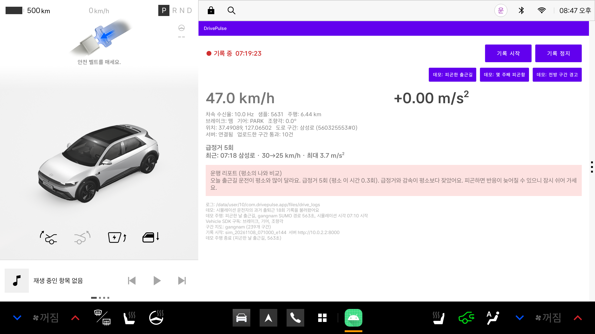
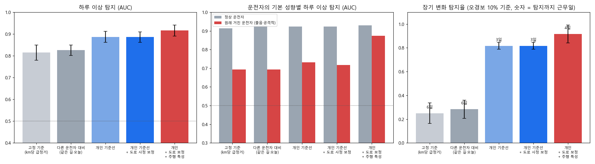

# DrivePulse

**같은 운전자의 같은 시간대·같은 경로(출퇴근길) 주행을 '평소의 나'와 비교해서, 오늘 운전이 이상한지와 운전이 서서히 바뀌고 있는지를 알려주는 Pleos Connect 앱**

출퇴근길은 매일 같은 길을 같은 시간에 달린다. 그래서 그 사람의 평소 주행이 가장 좋은 비교 기준이 된다. DrivePulse는 출퇴근마다 급정거·중간 세기 감속·가속도 변동·최대 감속도를 요약해 차 안에 쌓고, 새 출퇴근이 끝나면 같은 경로·시간대의 과거 기록과 비교한다.

- **하루 이상:** "오늘 출근길 운전이 평소와 많이 달라요. 급정거 5회 (평소 이 시간 0.1회)" → 피곤하거나 서두른 날을 그 자리에서 알려준다.
- **장기 변화:** "최근 출근길 운전이 꾸준히 달라지고 있어요 (10월 6일 무렵부터)" → 피로 누적이나 습관 변화처럼 몇 주에 걸친 변화를 알려준다.
- **도로 사정 보정:** 오늘 그 길이 원래 험했는지(다른 차들도 급정거가 많았는지)는 서버의 구간 기준선으로 확인해서, 도로 탓을 운전자 탓으로 돌리지 않는다.

고정 기준(예: km당 급정거 몇 회 이상이면 위험)은 원래 거칠게 운전하는 사람은 매일 경고하고, 원래 얌전한 사람의 이상한 날은 놓친다. 시뮬레이션 실험에서 하루 이상의 상위 K개 적중률은 고정 기준 0.07, DrivePulse 0.50이었고, 장기 변화 탐지율은 0.25 대 0.92였다.



*Pleos Connect 에뮬레이터: 평소 출근길 급정거 0.1회인 운전자가 피곤한 날 같은 길을 달린 뒤 뜬 운행 리포트*

## 구성

```
app/        Pleos Connect(Android Automotive) 앱: 차속·브레이크·위치 수집, 급정거·감속 감지,
            도로 구간 맵매칭, 개인 출퇴근 기준선(PersonalBaseline.kt), 운행 리포트, 전방 구간 경고
server/     Flask 서버: 익명 구간 통과 기록, 구간 × 시간대 기준선, 도로 사정 조회(trip_context), 경고 API
analysis/   개인 기준선 평가(personal.py), 구간 기준선(baseline.py), SUMO 교통 시뮬레이션(sumo_sim/),
            한국 OpenStreetMap 지도 변환(osm_korea.py), 실험 스크립트
docs/       보고서, 실험 결과, 그림
```

### 판정 방법 (앱과 분석 코드가 같은 계산)

1. **기대 급정거:** 이 운전자의 평소 비율 × 오늘 이 경로의 도로 기대값. 도로 기대값은 서버가 같은 구간·시간대의 다른 차량 기록으로 계산한다(평소 값과 오늘 값을 축소 추정으로 섞음).
2. **하루 판정:** 실제 급정거 수의 포아송 p값 + 주행 특성 3개(km당 중간 감속, 가속도 RMS, 최대 감속도)를 자기 과거 기록과 비교한 t분포 p값을 Fisher 방법으로 합친다. p < 10⁻³이면 "주의", p < 10⁻⁴이면 "경고"이다. 기록이 3회 모이기 전에는 학습 중으로 표시한다.
3. **장기 판정:** 처음 5 근무일을 기준으로 매일의 이탈 정도를 CUSUM으로 누적한다. 기준선을 넘으면 언제부터 달라졌는지와 함께 알려준다.

### 개인정보

개인 출퇴근 기록과 리포트는 **차 안에만** 저장된다. 서버로는 운전자·운행 ID 없이 "구간, 날짜, 시각, 급정거 수"만 익명으로 올라간다. 그래서 서버는 통과 기록을 이어 붙여 한 차의 경로를 만들 수 없다. 도로 사정을 물을 때도 구간과 시각만 보낸다.

## 실행 방법

### 1. 차량 앱 (Android Studio, Pleos Connect 에뮬레이터)

준비물: Android Studio, Pleos Connect Emulator(API 34) — [Pleos 개발 시작 가이드](https://document.pleos.ai/docs/pleos-only/getting-started)

```bash
./gradlew :app:assembleDebug
```

- 서버 주소 기본값은 `http://10.0.2.2:8000`(에뮬레이터에서 본 PC)이고, `-PdrivepulseServer=http://<주소>:8000`으로 바꿀 수 있다.
- Pleos 에뮬레이터는 차속을 바꿀 수 없어서, SUMO로 만든 강남 주행(시뮬레이션 시각 07:10 시작)을 재생하는 데모 버튼 세 개를 넣었다. 출퇴근 데모는 실제 기록과 섞이지 않게 데모용 기록 파일을 따로 쓰고, 시작할 때마다 과거 기록을 다시 불러와 날짜를 어제까지로 옮긴다. 데모 주행이 끝나면 **기록 정지**를 누른 뒤 다음 데모를 시작한다.
  - **데모: 피곤한 출근길** (`assets/demo_commute_gangnam.csv`): 평소 출근길을 피곤한 상태로 달린 주행. 같은 운전자의 과거 출근 18회(`assets/demo_history_gangnam.csv`)와 비교해 하루 이상 경고가 나온다.
  - **데모: 몇 주째 피곤함**: 같은 피곤한 주행인데, 과거 기록(`assets/demo_history_drift_gangnam.csv`)에 평소 18회 뒤로 점점 피곤해진 출근 12회가 이어진다. 하루 이상 경고와 함께 "최근 출근길 운전이 꾸준히 달라지고 있어요" 알림이 나온다. 이 기록은 `python export_app_assets.py --area gangnam --drift-demo out/personal/p_gangnam_s3`로 만든다.
  - **데모: 전방 구간 경고** (`assets/demo_trip_gangnam.csv`): 테헤란로를 지나다 장애물을 만나 급정거하는 주행. 다른 차의 주행이라 개인 출퇴근 기록과는 비교하지 않는다.
- 개인 기록: `adb exec-out run-as com.drivepulse.app --user 10 cat files/personal/commutes.csv` (데모는 `demo_commute.csv`, `demo_drift.csv`)

### 2. 개인 기준선 데모 (피곤한 날 출근길)

```bash
cd analysis                               # 데이터 생성 방법은 아래 3번
python export_app_assets.py --area gangnam --personal-demo out/personal/p_gangnam_s3   # 과거 출근 기록 + 피곤한 날 주행 (앱에 이미 들어 있음)
cd ..
python server/app.py seed analysis/out/personal/p_gangnam_s3/traversals.csv            # 도로 기준선용 익명 기록
python server/app.py serve --port 8000
```

앱에서 **데모: 피곤한 출근길**을 누르면, 주행이 끝날 때 운행 리포트가 뜬다.

전방 구간 경고 데모(도로 돌발)는 서버에 오늘 돌발을 심은 뒤 **데모: 전방 구간 경고**를 누르면 된다.

```bash
python server/app.py demo-today --segment "375049445#1" --start 07:10
```

### 3. 분석과 실험

필요: Python 3.11+, numpy, pandas, scipy, matplotlib, flask, `eclipse-sumo==1.28.0`, `libsumo==1.28.0`

```bash
cd analysis
python -m pytest -q                                   # 분석 테스트
python sumo_sim/generate.py --network osm --osm-area gangnam --days 28 --seed 3 --out out/personal/p_gangnam_s3
python personal.py out/personal/p_gangnam_s3          # 한 데이터셋 평가
python personal_experiments.py                        # out/personal/p_* 전체 → docs/results/personal.md
python experiments.py run                             # 구간 돌발 감지 실험 (도로 기준선 근거)
bash sumo_sim/run_year_all.sh                         # 1년치 데이터 5개 (각 약 2시간, 중단돼도 이어서 실행)
python personal_year.py                               # out/year/y_* → docs/results/personal_year.md
python real_check.py car01.csv --labels labels.csv    # 실제 차의 출퇴근 기록 점검 (아래)
```

**실제 출퇴근 기록 점검:** 차에서 `adb exec-out run-as com.drivepulse.app --user 10 cat files/personal/commutes.csv > car01.csv`로 기록을 받아 `real_check.py`에 넣으면 아래 내용을 보여준다.

- 평소 변동이 시뮬레이션과 얼마나 다른지
- 앱이 그동안 냈을 판정(주의·경고·장기 변화 알림)
- 운전자가 "그날 피곤했음"처럼 표시한 날을 잡았는지
- 다시 맞출 기준값

차가 없을 때는 `python real_check.py --from-sim out/year/y_gangnam_s4`로 SUMO 기록을 같은 형식으로 만들어 시험할 수 있다.

시뮬레이션 데이터에는 운전자 300명(정상 70%·졸음 15%·공격적 15%)과 배경 교통이 있고, 하루 이상(피로·조급한 날) 60건과 몇 주에 걸쳐 운전이 바뀌는 운전자 20명을 심어 정답을 알고 평가한다.

## 주요 결과

SUMO 시뮬레이션, 실제 한국 지도(강남 테헤란로·판교), 28일, 기본 강도 실험 3회 평균. 자세한 내용은 [보고서](docs/report.md)와 [개인 기준선 실험 결과](docs/results/personal.md)에 있다.

| 방법 | 하루 이상 AUC | 상위 K 적중률 | 원래 거친 운전자 AUC | 장기 변화 탐지율 (오경보 10%) |
|---|---|---|---|---|
| 고정 기준 (km당 급정거) | 0.81 | 0.07 | 0.69 | 0.25 |
| 다른 운전자 대비 (같은 길·오늘) | 0.83 | 0.12 | 0.69 | 0.28 |
| 개인 기준선 (급정거) | 0.89 | 0.45 | 0.73 | 0.82 |
| 개인 기준선 + 도로 사정 보정 | 0.89 | 0.46 | 0.72 | 0.82 |
| **개인 + 도로 보정 + 주행 특성 (DrivePulse)** | **0.92** | **0.50** | **0.87** | **0.92** |

- 가장 큰 차이는 **비교 대상을 '평소의 나'로 바꾸는 것**에서 나온다(적중률 0.07 → 0.45).
- 주행 특성(중간 감속, 가속도 변동)은 **원래 급정거가 잦은 운전자**에게서 효과가 크다. 이 사람들은 급정거만으로는 이상한 날이 평소와 잘 구분되지 않는다(0.72 → 0.87).
- 도로 사정 보정은 이 시뮬레이션에서는 평균 성능을 크게 바꾸지 않았다. 도로 돌발이 드물게만 출퇴근 경로와 겹치기 때문이다. 대신 돌발이 있는 날 운전자를 탓하지 않게 해 준다(테스트로 확인).
- 앱 경고 기준(p < 10⁻⁴)은 평소 출퇴근의 약 0.3%에서 울리고, 심은 이상한 날의 약 절반을 잡는다.

**도로 기준선의 근거 (구간 돌발 감지):** 구간 × 시간대 기준선은 심어 둔 도로 돌발의 92%를 찾았고, 급정거 횟수 순위나 도시 전체 평균 대비는 하나도 찾지 못했다([구간 실험](docs/results/stage1_experiments.md), [중간 단계 비교](docs/results/ablation.md)). 같은 기준선이 개인 판정의 "오늘 이 길의 기대 급정거"로 쓰이고, 전방 구간 경고 기능도 이것으로 동작한다.



**1년 동안 쓰면 ([1년 실험 결과](docs/results/personal_year.md)):** 운전자 100명 × 평일 1년에 날씨(비·눈), 공휴일, 휴가, 이직, 차량 교체를 넣고, 경고 기준을 한 데이터셋에서 정해 다른 데이터셋에 그대로 적용했다.

- 하루 이상: 1명당 연 약 2회 헛경보에서 이상한 날의 55%를 잡는다(고정 기준은 4%).
- 비 오는 날: 급정거만 보면 헛경보가 2배로 늘어난다. 같은 날 다른 사용자들의 운전과 비교해 보정하면 맑음·비·눈이 비슷해진다.
- 이직: 새 경로에서 기록을 새로 시작해야 헛경보가 안 늘어난다(100회당 2.6회 → 0.4회).
- 장기 변화: 빠른·느린·일시적 변화를 모두 잡는다(지연 약 4~18일). 기준은 계속 갱신해야 한다. 처음 20일로 고정하면, 그 기간이 우연히 조용했던 사람에게 1년 내내 경고가 난다.
- 앱은 이 결과대로 같은 경로의 최근 60회만 비교하고, 장기 변화는 80~20일 전을 기준으로 본다. 앱 판정을 그대로 옮겨 1년 데이터에서 확인하면 경고(p < 10⁻⁴)는 1명당 연 약 2.5회 울리고 이상한 날의 60%를 잡는다. 장기 변화 알림은 연 약 0.5회 울리고, 심은 변화를 거의 모두 잡는다(빠른 변화 98%, 느린·일시적 100%). 눈 오는 날처럼 모두가 천천히 달린 날은 장기 판정에서 뺀다.

## 한계

- 성능 수치는 모두 시뮬레이션(SUMO 운전 모델) 기준이다. 피로·조급함은 반응 시간·차간 거리·가속 성향을 바꿔서 흉내 낸 것이고, 실제 피곤한 운전자의 행동과 같다고 확인하지 않았다.
- 실제 출퇴근 데이터로 검증하지 않았다. 실차에서는 날씨, 동승자, 경로 변경 같은 요인이 더 섞인다.
- Pleos 에뮬레이터에서는 차속을 바꿀 수 없어서, 실제 차속 변화에 따른 감지는 실차에서 확인해야 한다.
- `CAR_SPEED`, `pleos.car.permission.CAR_DRIVE` 권한은 Pleos 앱마켓 심사 승인이 필요하다.
- 서버는 개발·데모용이다(평문 HTTP는 로컬 개발 주소에만 허용).

## 데이터와 라이선스 출처

- 지도: © OpenStreetMap contributors, [ODbL](https://opendatacommons.org/licenses/odbl/) — `app/src/main/assets/segments_*.csv`, `demo_trip_*.csv`, `demo_history_*.csv`는 OSM 기반 시뮬레이션에서 파생된 데이터이다.
- 교통 시뮬레이터: [Eclipse SUMO](https://eclipse.dev/sumo/) (EPL-2.0)
- 차량 SDK: Pleos Connect Vehicle SDK (42dot, Pleos SDK 라이선스)
