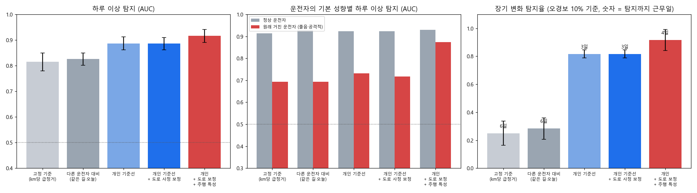
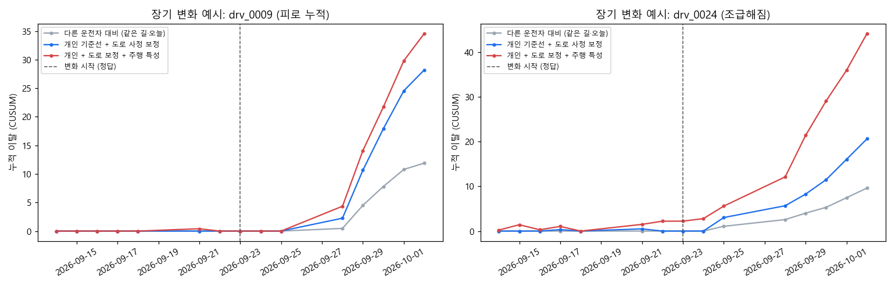
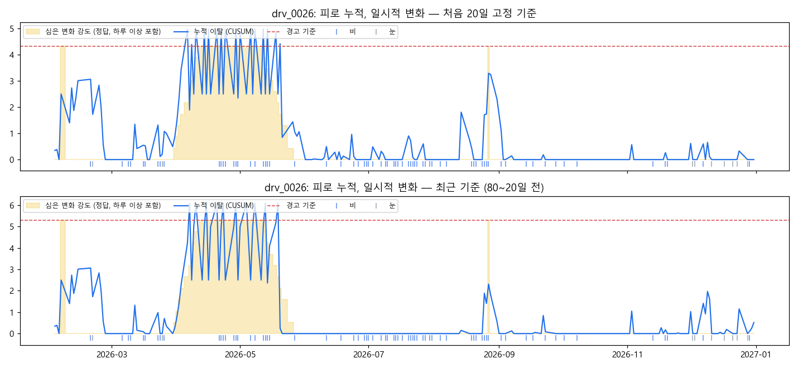
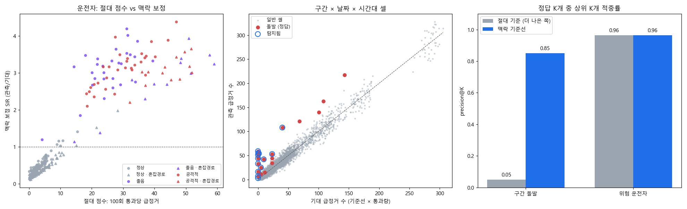
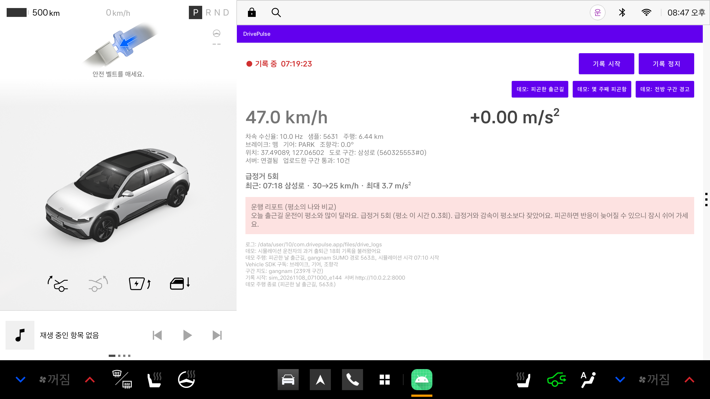
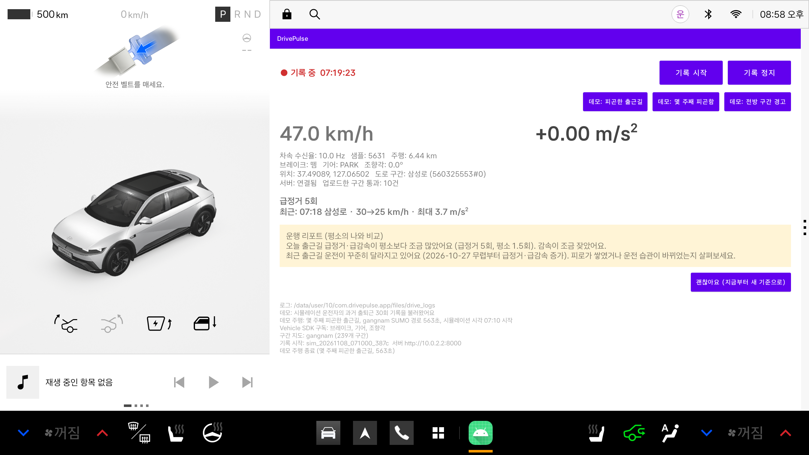
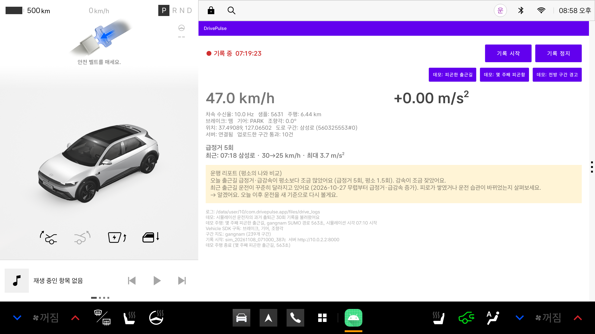
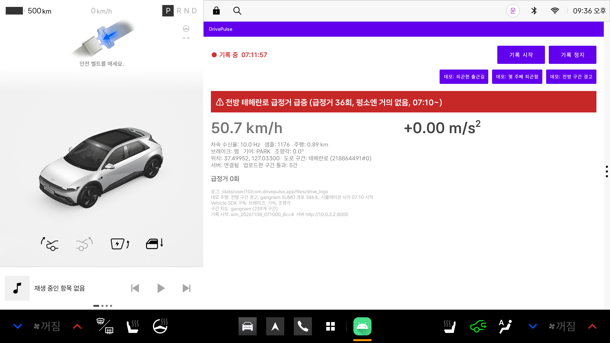

# DrivePulse 결과 보고서

**같은 운전자의 출퇴근길(같은 시간대·같은 경로) 주행 데이터로 하루 이상과 장기 변화를 찾는 Pleos Connect 시스템 — 개인 기준선, 도로 사정 보정, 시뮬레이션 검증**

작성일: 2026-11-07

## 요약

- **무엇:** 출퇴근은 매일 같은 길을 같은 시간에 달리므로, 그 사람의 평소 주행이 가장 좋은 비교 기준이다. DrivePulse는 출퇴근마다 급정거·중간 감속·가속도 변동·최대 감속도를 요약해 차 안에 쌓고, 새 출퇴근을 같은 경로·시간대의 과거 기록과 비교한다.
  - **하루 이상:** 오늘 출퇴근이 평소의 나와 다른가(피곤하거나 서두른 날)
  - **장기 변화:** 운전이 몇 주에 걸쳐 바뀌고 있는가, 언제부터인가(피로 누적, 습관 변화)
  - **도로 사정 보정:** 오늘 그 길이 원래 험했는지는 서버의 익명 구간 기준선(같은 구간·시간대의 다른 차들)으로 확인해서, 도로 탓을 운전자 탓으로 돌리지 않는다.
- **결과 (SUMO, 실제 강남·판교 지도, 28일, 3회):** 하루 이상의 상위 K 적중률이 고정 기준 0.07 → DrivePulse 0.50, 장기 변화 탐지율(오경보 10% 기준)이 0.25 → 0.92이다. 원래 거칠게 운전하는 사람의 이상한 날도 AUC 0.69 → 0.87로 잘 구분했다.
- **1년 동안 쓰면 (운전자 100명 × 평일 1년, 5회):** 비·눈, 공휴일, 휴가, 출발 시각 변동, 이직, 차량 교체를 넣고, 경고 기준을 한 데이터셋에서 정해 나머지에 그대로 적용했다. 앱 판정은 1명당 연 약 2.5회 경고를 내고 이상한 날의 60%를 잡는다. 장기 변화는 연 약 0.5회 헛경보에서 빠른 변화의 98%, 느린·일시적 변화는 모두 잡는다. 이 실험으로 앱을 세 가지 바꿨다. 새 경로는 기록을 새로 모으고, 장기 판정의 기준은 계속 갱신하고, 급정거는 그 운전자의 날마다 퍼짐으로 검정한다(6.5절).
- **도로 기준선의 근거:** 같은 구간 × 시간대 기준선은 심어 둔 도로 돌발의 92%를 찾았고, 급정거 횟수 순위는 0%였다. 이 기준선을 개인 판정의 도로 기대값과 전방 구간 경고에 함께 쓴다.
- **한계:** 모든 수치가 시뮬레이션 기준이고, 피로·조급함은 운전 모델 파라미터로 흉내 낸 것이다. 실제 출퇴근 데이터 검증은 향후 과제이다.

---

## 1. 배경과 문제

지금 서비스들의 운전 점수(TMAP 운전점수, 커넥티드카 안전운전 점수 등)는 급가속·급감속 횟수를 **모든 사람에게 같은 고정 기준**으로 센다. 그러면 두 가지 문제가 생긴다.

1. **사람마다 평소가 다르다.** 원래 급정거가 잦은 사람은 매일 나쁜 점수를 받고, 그 사람에게 정말 이상한 날은 평소와 구분되지 않는다. 원래 얌전한 사람의 이상한 날은 고정 기준을 넘지 못해 놓친다.
2. **길마다 평소가 다르다.** 막히는 길로 출퇴근하면 운전과 상관없이 급정거가 많다. 오늘 사고나 공사로 그 길이 유난히 험했다면, 그것도 운전자 탓으로 보인다.

출퇴근길은 이 두 문제를 풀기에 좋은 조건이다. 같은 사람이 같은 길을 같은 시간에 수십 번 달리므로, **그 사람의 그 길에서의 평소**를 기준으로 삼을 수 있다. 남은 변수인 "오늘 길 사정"은 같은 구간을 지난 다른 차들의 기록으로 보정한다.

## 2. 기존 기능 비교

| 구분 | 대표 사례 | 방식 | 한계 |
|---|---|---|---|
| 운전자 점수 | TMAP 운전점수, 현대·기아 커넥티드카 안전운전 점수 | 급가속·급감속·과속 횟수를 고정 기준으로 점수화 | 개인의 평소·길 사정 반영 없음, 하루 단위 변화 경고 없음 |
| 운행기록 분석 | 사업용 차량 운행기록(DTG) | 차종별 기준치 초과를 위험 행동으로 집계 | 고정 기준, 사업용 중심 |
| 졸음 경고 | 차량 내장 운전자 주의 경고(DAW 등) | 조향 패턴·카메라로 주행 중 졸음 감지 | 그 순간의 상태만, 운행 단위·장기 추세 비교 없음 |
| 구간 위험도 | Google Research 급정거 연구 (2026), Geotab 위험 지점 지도 | 구간별 급정거 빈도 장기 집계 | 장소 중심, 개인 운전자는 다루지 않음 |
| **DrivePulse** | — | 같은 경로·시간대의 **자기 과거 출퇴근** 대비 이탈 + 도로 사정 보정 | 이 보고서의 주제 |

## 3. 시스템 구성

```
[차량: Pleos Connect 앱]
  차속 (AAOS PERF_VEHICLE_SPEED, 10 Hz) ─┐
  브레이크·기어·조향각 (Pleos Vehicle SDK) ┼─> 급정거·중간 감속·가속도 변동 ─┐
  위치 → 도로 구간 맵매칭 ────────────────┘                                 │
                                                                            ▼
  개인 출퇴근 기록 (차 안에만 저장) ──> 운행 끝: 개인 기준선 판정 ──> 운행 리포트
                                             ▲
                         도로 기대값 조회 (구간·시각만 전송)
                                             │
[서버] 익명 구간 통과 기록 (구간, 날짜, 시각, 급정거 수) ─> 구간 × 시간대 기준선
                                             └─> 전방 구간 급정거 급증 경고
```

- **운행 요약:** 출퇴근 한 번을 날짜, 시간대(출근 05–11시, 퇴근 15–21시), 경로(첫 구간 > 마지막 구간), 거리, 급정거 수, 중간 감속(2.0 m/s² 이상) 수, 가속도 RMS(정차 제외), 최대 감속도로 요약한다.
- **구간 통과**는 서버 쪽 데이터 단위이다. 차량 한 대가 도로 구간 하나를 한 번 지나간 것이고, 그 구간에서 시작된 급정거 수가 붙는다. 운전자·운행 ID 없이 익명으로 올라간다.
- 도로 구간 ID는 OpenStreetMap에서 만든 SUMO 도로망의 구간 ID이다. 앱(맵매칭)·시뮬레이터·서버·분석이 모두 같은 ID를 쓴다.

## 4. 방법

### 4.1 급정거 판정 (차량)
- 0.5초 구간의 속도 기울기(최소제곱)로 감속도를 추정한다.
- 3.0 m/s²(약 0.3 g) 이상에서 시작, 1.5 m/s² 미만이거나 정지하면 종료이다(히스테리시스). 10 km/h 미만은 무시하고, 최소 0.3초 이상 이어져야 한다. 중간 감속은 같은 방식에 2.0/1.0 m/s² 기준이다.
- 앱(Kotlin)과 분석(Python)에 같은 로직이 있고, 같은 테스트 케이스로 두 구현이 같게 동작하는지 확인한다.

### 4.2 도로 기대값 (서버)
구간 s, 시간대 b의 평소 급정거율을 **그날을 뺀 다른 날들**의 기록으로 구하고(경험적 베이즈 축소, 7절), 오늘 같은 칸을 지난 다른 차들의 기록으로 한 번 더 보정한다.

```
usual(s, b)      = (Y_다른날 + k · 전체율) / (E_다른날 + k)                k = 20
today(s, b, d)   = (Y_오늘 + k · usual) / (E_오늘 + k)
E_usual(운행)    = Σ 통과마다 usual,   E_today(운행) = Σ 통과마다 today
```

차는 운행이 끝나면 지나간 구간과 시각만 보내고 E_usual, E_today를 받는다.

### 4.3 하루 판정 (차량)
같은 시간대·같은 경로의 **이전 날짜** 출퇴근 중 최근 60회와 비교한다. 같은 경로 기록이 3회 미만이면 다른 경로 기록을 빌려 쓰지 않고 "새 경로, 학습 중"으로 표시한다. 이직 직후 다른 경로 기록을 빌려 쓰면 헛경보가 크게 늘었기 때문이다(6.5절).

1. **급정거:** 개인 배율 `f = (Σ과거 급정거 + 2) / (Σ과거 E_today + 2)`, 기대 급정거 `μ = f × 오늘 E_today`. 길이 험한 날은 E_today가 커져서 기대치도 같이 올라간다. 실제 급정거 수의 위쪽 p값은 μ < 1이면 포아송으로, μ ≥ 1이면 그 운전자의 날마다 퍼짐 φ(과거 급정거의 분산/평균, 10회 분량으로 1 쪽으로 축소)를 쓴 정규 근사 `(y − 0.5 − μ) / √(φμ)`로 구한다. 원래 급정거가 잦은 운전자는 매일 비슷한 횟수로 급정거해서(φ ≈ 0.2~0.35) 포아송으로는 작은 증가를 놓친다.
2. **주행 특성 3개**(km당 중간 감속, 가속도 RMS, 최대 감속도): 자기 과거 평균과의 차이를 예측 t분포로 바꾼다. 분산은 과거 기록이 적을 때 모집단 분산(운전자 내 분산의 중앙값) 쪽으로 축소하고(3회 분량), 과거가 적을수록 꼬리를 두껍게(자유도 = 과거 수 + 3) 잡는다. 한 특성이 혼자 판정을 좌우하지 않도록 z는 4에서 자르고, 최대 감속도는 10 m/s²에서 자른다.
3. 네 p값을 Fisher 방법으로 합쳐 p < 10⁻³이면 **주의**, p < 10⁻⁴이면 **경고**이다. 과거 기록이 3회 미만이면 **학습 중**이다.
4. **피곤함·서두름 문구:** 주의·경고일 때 가속도 RMS가 중간 감속보다 자기 평소에서 더 크게 벗어났으면 "가속과 감속이 평소보다 거칠었어요. 서두르셨다면…", 아니면 "급정거와 감속이 평소보다 잦았어요. 피곤하면…"으로 안내한다. 피로는 반응이 늦어 감속이 잦아지고, 조급함은 가감속이 거칠어지는 패턴이다. 1년 실험에서 경고가 난 이상한 날의 84%가 맞았다(피곤한 날 93%, 서두른 날 76%).

### 4.4 장기 판정 (차량)
같은 시간대·경로의 출퇴근 날마다 (급정거 포아송 z + 특성 z 3개)/2를 계산해 단측 CUSUM(k = 0.5)으로 누적한다.

- **기준 기간:** 그날로부터 80~20일 전 기록이다(처음엔 첫 20일). 계속 따라 움직이므로 계절 변화가 흡수되고, 처음 몇 주가 우연히 조용했던 사람에게 1년 내내 경고가 나는 일이 없다. 20일 간격을 두어 진행 중인 변화가 기준에 바로 섞이지 않는다.
- **하루 값 상한:** 하루 값은 ±3에서 자른다. 이상한 하루 한 번은 하루 판정이 맡고, 장기 판정은 이어지는 변화에만 반응한다.
- **길이 유난히 순한 날 빼기:** 서버가 알려준 오늘 도로 기대값이 평소의 0.7배 미만인 날(시뮬레이션에서는 눈 오는 날: 0.4~0.7배, 맑은 날·비 오는 날은 0.8배 이상)은 기준과 누적에서 모두 뺀다. 이런 날은 모두가 천천히 달려서, 기준에 들어가면 그 뒤의 평범한 날이 나빠 보인다.
- **경보:** 누적값이 10.0을 넘으면 경보를 내고 0부터 다시 쌓는다. 최근 10일 안에 경보가 있었을 때만 리포트에 알리므로, 변화가 끝나면 알림도 사라진다. "변화 시작 무렵"은 그 경보 묶음 직전에 누적이 마지막으로 0이었던 날이다.
- **"괜찮아요":** 알림 아래 버튼을 누르면(이직·운전 습관 개선처럼 원하는 변화일 때) 그 시간대·경로는 그날 이후 기록만으로 다시 본다. 새 기준 20일이 쌓인 뒤부터 판정을 다시 시작한다.

### 4.5 기준값 보정
하루 판정 기준은 28일 시뮬레이션에서 정했다. 기록이 적을 때 쓰는 모집단 분산(km당 중간 감속 0.10, 가속도 RMS 0.014, 최대 감속도 0.36)은 1년 데이터의 평범한 출퇴근에서 경로·시간대별 분산의 중앙값이다. 28일 데이터에서 정했던 값(0.08, 0.012, 0.25)보다 처음 10회의 헛경보가 조금 적다. 평소 출퇴근에서 p < 10⁻³이 약 1%, p < 10⁻⁴가 약 0.3% 나온다(6.3절). CUSUM 기준 10.0은 1년 데이터 3개를 합쳐 앱 판정을 그대로 옮겨 "변화 없는 운전자에게 연 0.5회 알림"으로 정했다(6.5절). 데이터셋 하나에는 변화 없는 운전자가 50명뿐이라, 하나로 정하면 데이터셋마다 연 0.3~1회로 흔들렸다. 그 뒤에 새로 만든 2개(강남 시드 5, 판교 시드 4)에 같은 값을 그대로 적용하니 연 0.54회와 0.44회였고, 5개를 모두 합쳐 다시 정해도 10.03으로 거의 같았다.

## 5. 실험 설정

### 5.1 데이터: SUMO 교통 시뮬레이션
실제 출퇴근 데이터가 없어서, 정답을 알 수 있는 시뮬레이션으로 검증했다.

- **도로망:** OpenStreetMap에서 받은 실제 한국 도로. 도구가 한국 밖 좌표는 거부한다.
  - 강남 테헤란로 일대(강남역~삼성역): 구간 약 240개
  - 판교 테크노밸리(경부고속도로·분당내곡간 고속화도로 포함): 구간 약 560개
  - 차로 수·제한속도가 빠진 도로는 한국 기본값(보조·국지 간선 2차로, 도시 일반도로 50 km/h, 도시고속화도로 80 km/h)으로 채웠다. 이 보정 전에는 정상 운전자도 비현실적으로 급정거가 많았다(7.4절).
- **운전자:** 300명이 28일 동안 매일 같은 출퇴근길(출근 07–09시, 퇴근 17–19시)을 다닌다. 기본 성향은 정상 70%, 졸음 15%, 공격적 15%이다(EIDM 차량 추종 모델, 0.2초 간격). 그 밖에 익명 배경 교통과 하루 0.6건 확률의 도로 돌발(낙하물)이 있다.
- **하루 이상 60건:** 장기 변화가 없는 운전자 중에서, 둘째 주 이후의 근무일 출근 또는 퇴근 한 번을 골라 그 운행만 상태를 바꾼다.
  - **피로:** 반응 시간 +0.8초, 거리·속도 인지 오차 증가, 속도 약간 감소
  - **조급:** 차간 시간 40% 단축, 속도 +15%, 가감속 강화, 차간 거리 축소, 끼어들기 강화
- **장기 변화 20명:** 10~16일째부터 피로 또는 조급 상태가 7일에 걸쳐 서서히 최대 강도까지 올라가고 끝까지 유지된다.
- **급정거·특성 판정:** 모든 차량의 속도를 앱과 같은 판정 로직에 통과시킨다. SUMO 충돌 처리로 생긴 비현실적 기록(약 1만 운행에 1건)은 거른다.
- **실험:** 강남 시드 3·4, 판교 시드 3(기본 강도), 강남 시드 3에서 하루 이상만 강도 0.5로 줄인 실험 1회.

### 5.2 1년 데이터

28일로는 1년 단위 헛경보, 기준선 유지 방식, 계절과 생활 변화를 볼 수 없어서, 운전자 100명이 평일 1년(2026년, 약 245일) 출퇴근하는 데이터셋을 따로 만들었다(강남 시드 3·4·5, 판교 시드 3·4, 각각 SUMO 약 2시간).

- **경고가 나면 안 되는 변화**
  - **날씨:** 서울 월별 강수 일수로 만든 합성 날씨. 비는 모든 차(배경 교통 포함)의 반응을 늦추고 오차를 키워 급정거가 약 25% 늘고, 눈은 훨씬 느리게 달려 약 50% 줄어든다. 비 오는 날은 교통량도 10% 많다.
  - **달력:** 2026년 공휴일(대체공휴일 포함), 휴가(5~10 근무일 한 번 + 하루씩 며칠)
  - **평소 변동:** 출발 시각 ±10분, 매일 컨디션(주요 파라미터 ±4%)
  - **이직(10명):** 어느 날부터 새 직장으로 경로가 바뀐다.
  - **차량 교체(10명):** 어느 날부터 조금 더 부드럽게 달린다.
- **잡아야 하는 변화**
  - **하루 이상:** 1인당 연 평균 4회 (총 약 400건)
  - **장기 변화(30명):** 빠른 변화(1~2주 만에 최대, 유지), 느린 변화(2~3달에 걸쳐 증가), 일시적 변화(2주 증가, 3~6주 유지, 2주 회복)
- **평가 방식:** 경고 기준을 첫 데이터셋에서 "변화 없는 운전자 1명당 연 N회"로 한 번 정하고, 나머지 데이터셋에 그대로 적용한다. 표의 값은 나머지 4개의 평균이다.

### 5.3 비교 방법

| 방법 | 점수 | 의미 |
|---|---|---|
| 고정 기준 | km당 급정거 | 지금의 운전 점수 방식 |
| 다른 운전자 대비 | 실제 급정거 vs E_today (포아송) | 같은 길·같은 시간 다른 차들과 비교, 개인의 평소는 모름 |
| 개인 기준선 | 실제 급정거 vs f × E_usual | 자기 평소와 비교, 오늘 길 사정은 모름 |
| 개인 + 도로 보정 | 실제 급정거 vs f × E_today | 자기 평소 × 오늘 길 사정 |
| **개인 + 도로 보정 + 주행 특성** | 위 + 특성 3개 (Fisher) | DrivePulse 앱의 방식 |

### 5.4 평가 지표
- **하루 이상:** 과거 기록 3회 이상인 출퇴근(장기 변화 운전자 제외)에서 AUC(이상 운행을 정상 운행보다 높게 점수 매길 확률)와 상위 K 적중률(K = 심은 이상 수). 경보 수가 제한된 실제 서비스에 가까운 지표는 적중률이다.
- **장기 변화:** 모든 방법의 경보 기준을 "변화 없는 운전자의 10%가 경보"로 같게 맞춘 뒤 탐지율, 변화 시작부터 경보까지 걸린 근무일, 변화 시작 전 경보 수를 본다. 고정 기준은 최근 5 근무일의 km당 급정거 평균에 기준을 둔다.

## 6. 결과

### 6.1 하루 이상: 오늘 출퇴근이 평소의 나와 다른가 (기본 강도 3회 평균)

| 방법 | AUC | 상위 K 적중률 | 정상 운전자 AUC | 졸음·공격적 운전자 AUC | 피로 AUC | 조급 AUC |
|---|---|---|---|---|---|---|
| 고정 기준 (km당 급정거) | 0.81 ± 0.03 | 0.07 | 0.91 | 0.69 | 0.78 | 0.85 |
| 다른 운전자 대비 | 0.83 ± 0.02 | 0.12 | 0.93 | 0.69 | 0.79 | 0.86 |
| 개인 기준선 | 0.89 ± 0.02 | 0.45 | 0.92 | 0.73 | 0.83 | 0.93 |
| 개인 + 도로 보정 | 0.89 ± 0.02 | 0.46 | 0.92 | 0.72 | 0.83 | 0.93 |
| **개인 + 도로 보정 + 주행 특성** | **0.92 ± 0.02** | **0.50** | **0.93** | **0.87** | **0.87** | **0.95** |

- **비교 대상을 평소의 나로 바꾸는 게 핵심이다.** AUC는 0.81 → 0.89로 조금 오르지만, 상위 K 적중률은 0.07 → 0.45로 크게 오른다. 고정 기준의 상위 목록은 원래 급정거가 잦은 졸음·공격적 운전자의 평범한 날로 채워지기 때문이다.
- **주행 특성은 원래 거친 운전자에게 효과가 크다.** 이들은 평소에도 급정거가 많아서 급정거 수만으로는 이상한 날이 묻힌다(0.72). 가속도 변동·중간 감속을 더하면 0.87이다. 시뮬레이션에서 공격적 운전자가 조급해지면 급정거는 거의 그대로였지만 가속도 RMS는 1.00 → 1.42로 올랐다.
- **특성을 합치는 방식이 중요했다.** 처음엔 특성을 정규분포 z로 합쳤는데, AUC는 올라도 적중률이 0.29로 떨어졌다. 과거 기록이 3~5회일 때 분산 추정이 불안정하고, 최대 감속도는 한 번의 급정지로 크게 튀어서 평범한 날이 극단적 p값을 받았다. 예측 t분포와 z 상한(4)으로 바꾸자 적중률이 0.50으로 회복됐다.
- **도로 사정 보정의 평균 효과는 작았다.** 이 시뮬레이션에서는 도로 돌발이 출퇴근 경로와 겹치는 날이 드물기 때문이다. 대신 돌발이 있는 날 운전자를 탓하지 않는다는 점은 테스트로 확인했다(다른 차들도 8배 급정거한 날, 급정거 3회는 경고가 아님).

### 6.2 장기 변화: 운전이 몇 주에 걸쳐 바뀌고 있나

| 방법 | 탐지율 | 탐지까지 근무일 (중앙값) | 변화 시작 전 경보 |
|---|---|---|---|
| 고정 기준 (km당 급정거) | 0.25 ± 0.09 | 6.0 | 2.0명 |
| 다른 운전자 대비 | 0.28 ± 0.08 | 6.2 | 0.0명 |
| 개인 기준선 | 0.82 ± 0.03 | 3.0 | 0.0명 |
| 개인 + 도로 보정 | 0.82 ± 0.03 | 2.7 | 0.0명 |
| **개인 + 도로 보정 + 주행 특성** | **0.92 ± 0.08** | 3.7 | 0.3명 |

- 같은 오경보율에서 개인 기준선은 변화 운전자의 82~92%를 변화 시작 후 3~4 근무일 만에 찾았다. 고정 기준은 25%였다. 원래 급정거가 잦은 사람들이 고정 기준의 경보 자리를 차지하기 때문이다.
- 주행 특성을 더하면 더 많이 찾지만 약 하루 늦다. 특성은 변화가 쌓여야 뚜렷해지는 반면, 급정거는 변화 초기에 먼저 튀는 경우가 있기 때문이다.





### 6.3 앱 경고 기준의 동작 (기본 강도 3회)

| 기준 (합친 p값) | 평소 출퇴근 중 경보 비율 | 이상한 날 중 잡은 비율 | 경보 중 진짜 이상 비율 |
|---|---|---|---|
| p < 10⁻² | 약 4% | 0.71 ~ 0.84 | 0.10 ~ 0.11 |
| **p < 10⁻³ (주의)** | 약 1% | 0.57 ~ 0.74 | 0.25 ~ 0.28 |
| **p < 10⁻⁴ (경고)** | 약 0.3% | 0.42 ~ 0.64 | 0.43 ~ 0.55 |
| p < 10⁻⁶ | 0.0% | 0.17 ~ 0.42 | 0.90 ~ 0.95 |

하루 두 번 출퇴근하면 "주의"는 한 달에 0.5번쯤, "경고"는 반년에 한 번쯤 평범한 날에 울리는 수준이다. 심은 이상한 날은 전체 출퇴근의 약 0.5%라, 경고의 절반 정도가 진짜 이상이다.

### 6.4 하루 이상이 약할 때 (강도 0.5, 강남 시드 3)

| 방법 | AUC | 상위 K 적중률 | 졸음·공격적 운전자 AUC |
|---|---|---|---|
| 고정 기준 | 0.71 | 0.02 | 0.54 |
| 다른 운전자 대비 | 0.71 | 0.02 | 0.51 |
| 개인 기준선 | 0.79 | 0.22 | 0.59 |
| 개인 + 도로 보정 | 0.78 | 0.20 | 0.58 |
| 개인 + 도로 보정 + 주행 특성 | 0.76 | 0.18 | 0.63 |

효과가 절반이면 모든 방법이 떨어지고, 원래 거친 운전자의 이상한 날은 거의 구분되지 않는다. 이 경우 특성을 더한 방식이 급정거만 쓴 개인 기준선보다 약간 낮았다. 특성 3개의 잡음이 약한 신호보다 커지기 때문이다. 약한 변화는 하루 단위보다 장기 판정에서 잡는 게 맞다.

### 6.5 1년 동안 쓰면 (강남 시드 4·5, 판교 시드 3·4 평균)

자세한 표: [1년 실험 결과](results/personal_year.md)

**하루 이상** (경고 기준: 변화 없는 운전자 1명당 연 2회 헛경보)

| 방법 | 헛경보 (1인·연) | 탐지율 | 졸음 성향 | 거친 성향 |
|---|---|---|---|---|
| 고정 기준 (km당 급정거) | 0.7 | 4% | 8% | 20% |
| 개인 + 도로 보정 | 2.4 | 56% | 18% | 25% |
| **개인 + 도로 보정 + 주행 특성** | 1.8 | 53% | 38% | 41% |

- **비·눈:** 급정거만 보면 비 오는 날 헛경보가 맑은 날의 2배가 넘는다(100회당 0.40 → 0.87). 배경 교통으로 보는 도로 보정이 비 효과를 다 덜어내지 못한다. 주행 특성을 더하면 0.38 → 0.56으로 줄어든다. 눈 오는 날은 모두 천천히 달려서 헛경보가 거의 없다.
- **기준선 유지:** 과거 전체와 최근 60회는 거의 같다(헛경보 2.0 vs 2.0, 탐지 55% vs 56%). 처음 20회로 고정하면 탐지율이 50%로 떨어지고, 1년 뒤쪽일수록 더 낮다. 출퇴근 10회 정도 쌓인 뒤로는 탐지율이 크게 오르지 않는다.
- **이직:** 시간대로만 기록을 묶으면 새 경로 첫 30회의 헛경보가 100회당 0.3회에서 2.6회로 뛴다. 경로별로 기록을 새로 시작하면 0.4회이다. **차량 교체**는 경고를 늘리지 않았다.

**장기 변화** (경보 기준: 변화 없는 운전자 연 0.5회)

| 기준 기간 | 방법 | 헛경보 (1인·연) | 빠른 / 느린 / 일시적 탐지 (지연 근무일) | 일시적 변화가 끝난 뒤 조용해짐 |
|---|---|---|---|---|
| 처음 20일 고정 | 고정 기준 (5일 평균 km당 급정거) | 0.69 | 27% / 28% / 27% | 89% |
| 처음 20일 고정 | 개인 + 도로 보정 + 주행 특성 | 0.47 | 98% (11) / 100% (24) / 100% (13) | 92% |
| **80~20일 전 (갱신)** | **개인 + 도로 보정 + 주행 특성** | 0.55 | 100% (6) / 100% (18) / 100% (6) | 95% |

- **고정 기준 기간의 문제:** 처음 20일이 우연히 조용했던 운전자는 1년 내내 경보가 난다. 판교의 한 정상 운전자는 1월 급정거가 출퇴근 1회당 0.41회였고(그 뒤로는 약 1.2회, 전체 운전자의 맑은 날 평균은 달마다 거의 같음), 기준을 고정하면 혼자 23번 경보가 났다. 기준을 계속 갱신하면 이런 경우가 줄고, 느린 변화(2~3달)도 놓치지 않았다.
- **이직 뒤 60일:** 운전자 단위로 묶어 판정하면 30%가 경보를 받았다(데이터셋마다 10명 중 1~6명). 변화 없는 운전자가 아무 60일 동안 경보를 받을 확률은 약 13%라 그보다 높다. 새 경로의 운전이 옛 경로 기준과 비교되기 때문이다. 앱은 경로별로 따로 판정해서, 다섯 데이터셋을 합치면 이직한 50명 중 7명(14%)에게 알림이 갔고 변화 없는 운전자의 같은 확률(약 12%)과 비슷하다.

**앱 판정 그대로** (같은 경로·시간대의 최근 60회, 운전자별 급정거 퍼짐, 장기 판정은 시간대·경로별 갱신 기준, 길이 유난히 순한 날 제외, H = 10.0)

| 판정 | 헛경보 (1인·연) | 탐지율 |
|---|---|---|
| 하루: 주의 (p < 10⁻³) | 6.9 | 70% |
| 하루: 경고 (p < 10⁻⁴) | 2.5 | 60% (정상 64%, 졸음 성향 45%, 거친 성향 52%) |
| 장기 변화 (알림 수) | 0.54 (강남 0.66·0.54, 판교 0.54·0.44; 기준을 정할 때 쓴 강남 시드 3은 0.34) | 빠른 98%, 느린·일시적 100% (지연 6 / 22 / 7 근무일) |

출퇴근을 하루 두 번 하면 "경고"는 평범한 날 기준으로 5개월에 한 번쯤 울린다. 장기 변화 알림은 1년에 한 번이 안 된다.

- **지역 차이와 눈:** 처음에는 같은 기준에서 판교의 장기 변화 헛경보가 강남의 약 2배(연 0.96 vs 0.5)였다. 헛경보를 달별로 보니 3~5월에 몰려 있었다. 눈 오는 1~2월이 기준 기간(80~20일 전)에 들어가면 봄의 평범한 날이 나빠 보였던 것이다(눈이 적은 강남 시드 4에서는 몰리지 않음). 서버의 도로 기대값 비로 눈 오는 날을 빼고 기준을 데이터셋을 합쳐 정하자 연 0.34~0.66회로 좁혀졌다(다섯 데이터셋 모두 이 범위). "두 번 연속 경보일 때만 알림" 규칙도 시험했지만 차이가 없었다.



### 6.6 '오늘 다른 사용자' 보정을 넣지 않은 이유

도로 사정 보정은 배경 교통(익명 구간 통과)의 급정거로 오늘 길 사정을 본다. 이것과 별개로 **오늘 같은 시간대에 다른 앱 사용자들이 각자의 평소보다 얼마나 달랐는지**로 한 번 더 보정하는 방식을 1년 데이터로 시험했다. 각 사용자의 이탈을 같은 날 사용자들의 중앙값으로 빼고, 그날의 퍼짐(MAD)으로 나눈다. 날씨처럼 모든 운전자에게 함께 오는 영향을 지우려는 것이다.

| 비교 (나머지 4개 데이터셋 평균) | 도로 보정 + 주행 특성 | + 다른 사용자 보정 |
|---|---|---|
| 하루 이상: 헛경보 / 탐지율 | 1.8회 / 53% | 2.0회 / 55% |
| 하루 이상: 100회당 헛경보 (맑음 / 비 / 눈) | 0.38 / 0.56 / 0.00 | 0.43 / 0.57 / 0.65 |
| 장기 변화 (갱신 기준): 헛경보 / 지연 (빠른·느린·일시적) | 0.55회 / 6·18·6일 | 0.63회 / 4·18·5일 |

- **효과가 작다.** 하루 판정은 헛경보와 탐지율이 함께 조금 오를 뿐이고, 비 오는 날 헛경보는 그대로인데 눈 오는 날 헛경보가 생긴다. 장기 판정은 1~2일 빨라지지만 헛경보가 늘어난다. 이 보정이 크게 도왔던 경우는 처음 20일로 고정한 기준(계절이 바뀌면 모두가 함께 달라 보임)뿐이었고, 앱은 이미 기준을 계속 갱신하고 눈 오는 날을 뺀다(6.5절).
- **개인정보 비용이 있다.** 이 보정에는 차마다 "오늘 내가 평소보다 얼마나 달랐는지"를 서버에 보내야 한다. 지금 앱은 개인 기록과 판정을 차 밖으로 보내지 않는다.
- **넣는다면 이런 방식이다:** 출퇴근마다 숫자 하나(오늘 이탈 z, 0.5 단위로 반올림, 작은 잡음 추가)를 날짜·시간대·넓은 지역만 붙여 익명으로 보낸다. 구간 통과 업로드와는 따로, 시간을 흩어 보내 서로 연결되지 않게 한다. 서버는 같은 칸에 20명 이상 모였을 때만 중앙값과 퍼짐을 알려준다.
- **다시 볼 조건:** 실제 출퇴근 데이터에서 비 오는 날 헛경보가 시뮬레이션보다 훨씬 크게 늘거나, 배경 교통이 적어 도로 보정이 잘 안 되는 지역이 많으면 이 방식을 다시 검토한다.

## 7. 도로 기준선 검증: 구간 × 시간대 기준선이 길 사정을 제대로 나타내나

개인 판정의 E_today와 전방 구간 경고는 같은 구간 기준선을 쓴다. 이 기준선이 "오늘 이 길이 평소와 다른지"를 제대로 잡는지는 도로 돌발 감지로 따로 검증했다(같은 SUMO 설정, 운전자 상태 변화 없음, 5회).

### 7.1 기준선 (경험적 베이즈, 날짜 하나씩 빼고 계산)
구간 s, 시간대 b(평일/주말 × 새벽·출근·낮·퇴근·저녁)의 기대 급정거율을 그날을 뺀 다른 날들의 기록으로 구한다.

```
prior(s, b)  = 구간 s의 전체 급정거율 × 시간대 b의 전체 대비 배율
λ(s, b)      = (Y_다른날 + k · prior) / (E_다른날 + k)       Y: 급정거 수, E: 통과 수, k = 30
```

구간 이상은 관측 급정거 수를 기대치와 비교하는 포아송 검정 + Benjamini–Hochberg(FDR 5%)로 판정하고, 시간대 안은 10~30분 창으로 다시 스캔한다.

### 7.2 결과: 어느 부분이 효과를 내나

| 기준선 | 실제로 급정거를 늘린 돌발 중 찾은 비율 | 자체 판정 정밀도 |
|---|---|---|
| 기준선 없음 (급정거 횟수 순위) | 0.00 | — |
| 도시 전체 평균 대비 | 0.00 | 0.00 |
| 시간대 평균 대비 | 0.00 | 0.00 |
| 구간 평균 대비 | 0.89 ± 0.09 | 0.89 |
| 구간 × 시간대 (보정 없음) | 0.82 ± 0.09 | 0.66 |
| **구간 × 시간대 + 축소 보정** | **0.92 ± 0.06** | 0.81 |

- **핵심은 구간별 기준선이다.** 원래 급정거가 많은 혼잡 구간이 늘 상위를 차지해서, 구간을 구분하지 않으면 돌발을 하나도 못 찾았다. 개인 판정에서 "고정 기준"이 실패한 것과 같은 이유이다. 개인이든 길이든 **각자의 평소**와 비교해야 한다.
- 시간대 구분의 몫은 작았고(0.89 → 0.92), 칸을 잘게 나누면 축소 보정이 필요했다.
- 자세한 표: [구간 반복·민감도 실험](results/stage1_experiments.md), [중간 단계 비교](results/ablation.md)



### 7.3 다른 운전자 대비 점수
같은 기준선으로 운전자의 급정거를 "다닌 길의 기대치" 대비로 보면(SIR), 위험 운전자를 찾는 정확도는 횟수 기준과 비슷했다(0.96 → 0.98). 차이는 공정성이었다. 정상 운전자의 점수와 다니는 길의 혼잡도 사이 상관이 0.42에서 0.05로 줄었다. 하지만 6.1절에서 보듯, 하루 이상을 찾는 데는 다른 운전자 대비만으로는 부족하고 개인의 평소가 필요하다.

### 7.4 실험 과정에서의 변화 (정직한 기록)
처음 만든 강남 시뮬레이션은 정상 운전자도 100회 통과당 22.7회 급정거했다. OSM에 차로 수가 없으면 보조간선이 1차로가 되고, 제한속도가 없으면 테헤란로가 100 km/h가 됐기 때문이다. 한국 기본값으로 채우자 2.6~3.6회로 내려왔고, 보정 전에 크게 보였던 "다른 운전자 대비"의 이점(위험 운전자 적중률 0.60 → 0.92)은 대부분 사라졌다. 비현실적인 도로망이 길 효과를 과장했던 것이다.

## 8. 차량 앱 데모 검증 (Pleos Connect 에뮬레이터)

### 8.1 피곤한 날 출근길 (개인 기준선)

- **시나리오:** 시뮬레이션 데이터(강남 시드 3)에서 하루 이상·장기 변화가 없는 정상 운전자 한 명(언주로 → 삼성로, 6.4 km)을 골랐다. 이 사람의 과거 출근 18회를 앱의 출퇴근 기록으로 넣고, 같은 길을 **피로 상태**(5.1절의 피로 파라미터)로 달린 주행을 앱 시뮬레이션 모드로 재생했다. 서버에는 같은 데이터의 익명 구간 통과 약 190만 건을 넣었다.
- **평소 기록:** 출근 18회 평균 급정거 0.11회, 중간 감속 3.9회, 가속도 RMS 0.59, 최대 감속도 2.9 m/s².
- **오늘:** 급정거 5회, 중간 감속 13회, 가속도 RMS 0.68, 최대 감속도 4.4 m/s².
- **판정 경로:** 앱이 맵매칭한 경로(첫 구간 > 마지막 구간)가 과거 기록의 경로와 정확히 일치해 같은 경로 기록으로 비교했다. 서버에서 받은 도로 기대값은 E_usual 1.24, E_today 1.30으로 평소 범위였다(길 사정은 평소와 같음).
- **결과:** 주행이 끝나자 **경고** 단계 리포트가 떴다. "오늘 출근길 운전이 평소와 많이 달라요. 급정거 5회 (평소 이 시간 0.3회). 급정거와 감속이 평소보다 잦았어요. 피곤하면 반응이 늦어질 수 있으니 잠시 쉬어 가세요." 피곤한 상태로 달린 주행이라 '피곤함' 문구가 맞게 나왔다. 이 운행은 기록에 추가되어 다음 비교에 쓰인다.



### 8.2 몇 주째 피곤한 출근길 (장기 변화)

- **시나리오:** 8.1과 같은 운전자의 평소 출근 18회 뒤에, 같은 길을 피로 강도 0.5에서 1.0까지 점점 높여 SUMO로 달린 출근 12회를 이어 붙였다. 이 12회의 급정거는 0~1회에서 3~6회로 늘었다(평소 평균 0.11회). 오늘 주행은 8.1과 같은 피곤한 출근길이다.
- **결과:** 리포트에 하루 판정(주의, "급정거 5회, 평소 1.5회. 감속이 조금 잦았어요")과 함께 **장기 변화 알림**이 떴다. "최근 출근길 운전이 꾸준히 달라지고 있어요 (10월 27일 무렵부터 급정거·급감속 증가)." 점점 피곤해진 12회가 최근 기록에 들어가서 하루 판정의 "평소"도 1.5회로 올라갔다. 그래서 하루 판정만으로는 점점 나빠지는 변화가 덜 드러나고, 장기 판정이 그 부분을 알려준다.
- **"괜찮아요":** 알림 아래 버튼을 누르면 확인 문구("오늘 이후 운전을 새 기준으로 다시 볼게요")가 붙고, 그날 날짜가 데모 기록 옆 파일에 저장된다.
- 8.1의 데모(평소 18회만)에서는 장기 변화 알림이 나오지 않는다. 두 데모는 실제 기록과 섞이지 않게 각자의 기록 파일을 쓰고, 날짜는 어제까지의 근무일로 옮겨서 언제 실행해도 같다.





### 8.3 전방 구간 경고 (도로 기준선)

- SUMO로 만든 강남 주행(서초대로 → 테헤란로, 약 6분)에 장애물을 두고, 서버에는 "오늘 07:10 테헤란로 돌발" 데모 데이터를 넣었다.
- 앱이 고른 도로 구간이 SUMO의 실제 구간과 **99.7%** 일치했고(교차로 내부 제외), 전방 테헤란로 구간의 급정거 급증 경고가 화면에 떴다. 장애물 지점의 급정거(51→6 km/h, 최대 5.5 m/s²)는 해당 구간의 익명 통과 기록으로 서버에 올라갔다.
- 서버는 통과 기록 약 200만 건에 대한 탐지를 약 14초에 끝내고, 1분마다 백그라운드에서 다시 계산한다.



## 9. 한계

1. **실제 데이터 검증 없음:** 모든 성능 수치가 SUMO 운전 모델 기준이다. 피로·조급함은 반응 시간·차간 거리·가감속 파라미터로 만든 가상 상태이고, 실제 피곤한 운전자의 행동과 같다고 확인하지 않았다.
2. **생활 변화는 일부만:** 1년 데이터에 출발 시각 변동, 날씨, 휴가, 이직, 차량 교체를 넣었지만, 동승자, 공사로 인한 장기 우회, 다른 시간대의 출근 같은 변화는 아직 없다. 날씨 효과의 크기도 운전 모델 파라미터로 정한 값이다.
3. **기록이 쌓이기 전:** 같은 경로·시간대 기록이 3회 모이기 전에는 판정하지 않고, 장기 판정은 같은 경로 출퇴근이 23일 쌓여야 시작한다. 처음 20일 동안은 그 기간이 평소라고 가정한다.
4. **원래 거친 운전자의 조급한 날:** 급정거 수가 거의 그대로이고(km당 1.22 → 1.18), 최대 감속도와 가속도 변동만 달라진다. 날마다 퍼짐을 쓰는 급정거 검정으로 같은 헛경보에서 32% → 39%가 됐지만 여전히 절반 넘게 놓친다. 특성의 z 상한을 올리면 이 경우는 조금 늘지만 전체 탐지율이 떨어졌고, 평균 속도·속도 변동 특성은 도움이 되지 않았다. 차로 변경 횟수도 시험했다(강남 시드 3의 출근 37회를 차로 변경을 세며 다시 시뮬레이션). 서두른 날에 오히려 줄거나 그대로였다(자기 평소 대비 AUC 0.35~0.54). SUMO에서 '서두름'은 더 좁은 틈에 끼어드는 것이지 차로를 더 자주 바꾸는 게 아니고, 차로 변경 횟수는 주로 경로가 정한다. 실제 차에서 조향각으로 차로 변경을 세면 다를 수 있지만, 시뮬레이션으로는 근거가 없어서 앱에 넣지 않았다.
5. **장기 변화 헛경보의 흔들림:** 눈 오는 날을 빼고 나서도 같은 기준이 데이터셋마다 연 0.34~0.66회이다. 변화 없는 운전자 250명·1년으로 확인한 값이라, 실제 서비스에서는 사용자 기록으로 다시 맞춰야 한다.
6. **차속 변화 검증:** Pleos 에뮬레이터(user 빌드)는 차속을 바꿀 수 없어서, 실제 차속 신호로 감지하는 건 실차에서 확인해야 한다.
7. **도로 기준선의 데이터 양:** 도로 사정 보정은 같은 구간·시간대를 지나는 차가 충분해야 의미가 있다. 통행량이 적은 길에서는 보정이 평소 값으로 돌아간다.
8. **심사·개인정보:** `CAR_SPEED`, `CAR_DRIVE` 권한은 Pleos 앱마켓 승인이 필요하다. 개인 기록은 차 안에만 두고 서버에는 익명 구간 통과만 보내지만, 실서비스 전에 보관 기간과 동의 절차를 정해야 한다.

## 10. 향후 과제

- **실데이터 검증:** 본인 차량 출퇴근 기록을 몇 주 모아 평소 변동의 크기와 기준값을 다시 맞추기. 점검 도구(`analysis/real_check.py`)는 준비돼 있다. 차에 쌓인 출퇴근 요약(`commutes.csv`)과 운전자가 표시한 날을 넣으면 다음을 보여준다.
  - 평소 변동이 시뮬레이션과 어떻게 다른지(급정거 분산/평균, 가속도 RMS 변동계수, 특성 분산)
  - 앱이 그동안 냈을 판정
  - 표시한 날을 잡은 비율
  - 연 2회 경고가 되는 p값 기준과 특성 모집단 분산 제안

  SUMO 기록으로 시험하면 시뮬레이션 수치(분산/평균 0.92, 변동계수 0.127)와 같게 나온다.
- **밤·주말:** 출퇴근 밖 시간대의 평소를 따로 쌓기
- **실차 시험:** Pleos 실차 또는 개발 차량에서 차속·위치 실측 검증, 리포트 문구와 시점에 대한 운전자 반응 평가

## 참고 자료

- Google Research, *Hard-braking events as indicators of road segment crash risk* (2026), arXiv:2601.06327
- Geotab, *Hazardous Driving Areas* (data.geotab.com)
- Pleos Playground 개발자 문서: https://document.pleos.ai
- Eclipse SUMO: https://eclipse.dev/sumo/
- 지도 데이터: © OpenStreetMap contributors (ODbL)
