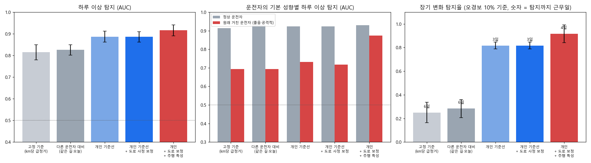
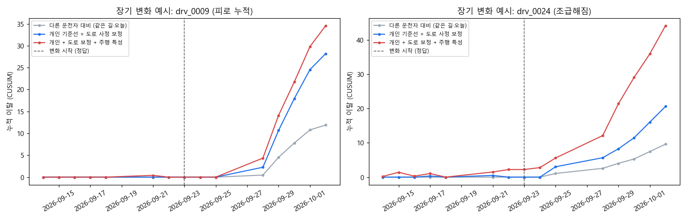

# 개인 출퇴근 기준선: 하루 이상과 장기 변화 탐지

SUMO, 실제 한국 지도, 28일, 운전자 300명(정상 70%·졸음 15%·공격적 15%) + 배경 교통. 각 실험에 하루 이상 60건(피로/조급), 장기 변화 운전자 20명을 심었다. 기본 강도 실험 3회 평균 ± 표준편차.

## 1. 하루 이상: 오늘 출퇴근이 '평소의 나'와 다른가

평가 대상은 같은 경로·시간대 기록이 3회 이상 쌓인 뒤의 출퇴근이다. AUC는 이상 운행을 정상 운행보다 높게 점수 매길 확률이고(0.5 = 무작위), 적중률은 점수 상위 K개(K = 심은 이상 수) 중 진짜 이상의 비율이다.

| 방법 | AUC | 상위 K 적중률 | 정상 운전자 AUC | 졸음·공격적 운전자 AUC | 피로 AUC | 조급 AUC |
|---|---|---|---|---|---|---|
| 고정 기준 (km당 급정거) | 0.81 ± 0.03 | 0.07 | 0.91 | 0.69 | 0.78 | 0.85 |
| 다른 운전자 대비 (같은 길·오늘) | 0.83 ± 0.02 | 0.12 | 0.93 | 0.69 | 0.79 | 0.86 |
| 개인 기준선 | 0.89 ± 0.02 | 0.45 | 0.92 | 0.73 | 0.83 | 0.93 |
| 개인 기준선 + 도로 사정 보정 | 0.89 ± 0.02 | 0.46 | 0.92 | 0.72 | 0.83 | 0.93 |
| 개인 + 도로 보정 + 주행 특성 | 0.92 ± 0.02 | 0.50 | 0.93 | 0.87 | 0.87 | 0.95 |

## 2. 장기 변화: 운전이 몇 주에 걸쳐 바뀌고 있나, 언제부터

모든 방법의 경보 기준을 '변화 없는 운전자 중 10%에서 경보'가 되도록 똑같이 맞춘 뒤 비교했다. 기준 기간은 각 운전자의 첫 5 근무일이다.

| 방법 | 탐지율 | 탐지까지 걸린 근무일 (중앙값) | 변화 시작 전 경보 |
|---|---|---|---|
| 고정 기준 (km당 급정거) | 0.25 ± 0.09 | 6.0 | 2.0명 |
| 다른 운전자 대비 (같은 길·오늘) | 0.28 ± 0.08 | 6.2 | 0.0명 |
| 개인 기준선 | 0.82 ± 0.03 | 3.0 | 0.0명 |
| 개인 기준선 + 도로 사정 보정 | 0.82 ± 0.03 | 2.7 | 0.0명 |
| 개인 + 도로 보정 + 주행 특성 | 0.92 ± 0.08 | 3.7 | 0.3명 |

## 3. 하루 이상이 약할 때 (강도 0.5, 강남 시드 3)

피로·조급의 효과를 절반으로 줄인 하루 이상만 다시 심었다(장기 변화는 그대로라 표에서 뺐다).

| 방법 | 하루 이상 AUC | 상위 K 적중률 | 졸음·공격적 운전자 AUC |
|---|---|---|---|
| 고정 기준 (km당 급정거) | 0.71 | 0.02 | 0.54 |
| 다른 운전자 대비 (같은 길·오늘) | 0.71 | 0.02 | 0.51 |
| 개인 기준선 | 0.79 | 0.22 | 0.59 |
| 개인 기준선 + 도로 사정 보정 | 0.78 | 0.20 | 0.58 |
| 개인 + 도로 보정 + 주행 특성 | 0.76 | 0.18 | 0.63 |

## 실험별 값

| 실험 | 이상 수 | AUC 고정 기준 (km당 급정거) | AUC 다른 운전자 대비 (같은 길·오늘) | AUC 개인 기준선 | AUC 개인 기준선 + 도로 사정 보정 | AUC 개인 + 도로 보정 + 주행 특성 |
|---|---|---|---|---|---|---|
| 강남 시드 3 | 49 | 0.83 | 0.83 | 0.89 | 0.89 | 0.89 |
| 강남 시드 3 (변화 강도 0.5) | 49 | 0.71 | 0.71 | 0.79 | 0.78 | 0.76 |
| 강남 시드 4 | 52 | 0.78 | 0.80 | 0.86 | 0.86 | 0.93 |
| 판교 시드 3 | 50 | 0.84 | 0.84 | 0.91 | 0.91 | 0.93 |

