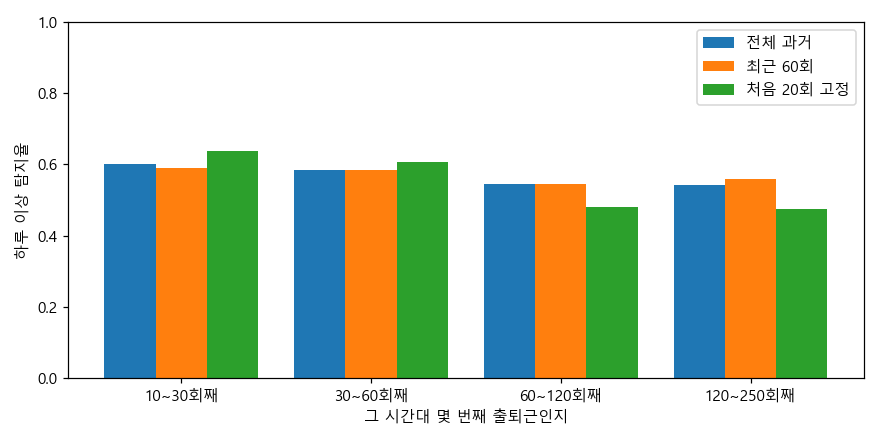
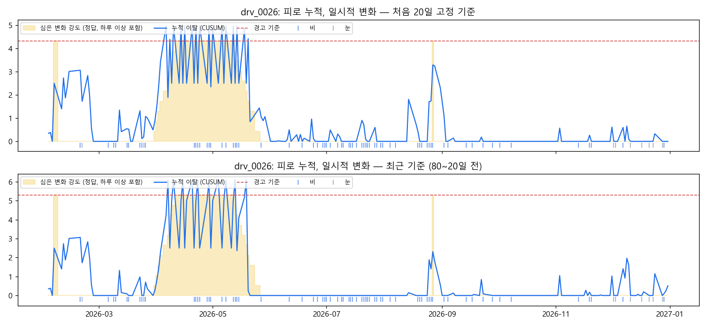

# 1년 출퇴근: 개인 기준선이 생활 변화에 조용하고, 잡을 건 잡는가

SUMO 실제 한국 지도, 운전자 100명 × 평일 1년(약 245일) 출퇴근, 데이터셋 5개(강남 시드 3, 강남 시드 4, 강남 시드 5, 판교 시드 3, 판교 시드 4). 데이터 생성 방식은 `analysis/sumo_sim/life.py` 참고. 날씨(서울 기후 기반 비·눈), 공휴일, 휴가, 출발 시각 ±10분, 매일 컨디션, 이직(새 경로), 차량 교체는 **경고가 나면 안 되는** 변화, 하루 이상(1인당 연 4회)과 장기 변화(30명: 빠른·느린·일시적)는 **잡아야 하는** 변화이다.

경고 기준은 **첫 데이터셋(강남 시드 3)에서 한 번 정하고** 나머지에 그대로 적용했다 (하루 이상: 운전자 1명당 연 2회 헛경보, 장기 변화: 연 0.5회). 표의 값은 나머지 데이터셋 4개의 평균(± 표준편차)이다. 헛경보는 아무 변화도 없는 운전자(장기 변화·이직·차량 교체 없음)의 평범한 출퇴근에서 센 것이다.

## 요약

- **하루 이상**: 운전자 1명당 연 2.0회 헛경보에서 하루 이상의 55%를 잡는다. 같은 헛경보에서 고정 기준(km당 급정거)은 4%이다. 주행 특성을 더하면 원래 졸음·거친 성향인 운전자의 탐지율이 18%/25%에서 43%/45%로 올라간다.
- **비·눈**: 급정거만 보면 비 오는 날 헛경보가 맑은 날의 2.2배이다 (배경 교통으로 본 도로 사정 보정이 운전자들의 비 효과를 다 반영하지 못함). '오늘 다른 사용자' 보정을 더하면 맑음·비·눈 헛경보가 0.43/0.57/0.65회(100회당)로 비슷해진다.
- **기준선 유지**: 전체 과거와 최근 60회는 차이가 거의 없다. 처음 20회로 고정하면 헛경보는 줄지만 탐지율도 50%로 떨어진다. 앱은 최근 60회 기준으로 충분하다.
- **이직**: 시간대별로만 기록을 묶으면 새 경로의 첫 30회에서 헛경보가 100회당 2.6회로 뛴다. 경로·시간대별로 묶어 새 경로에서 기록을 새로 시작하면 0.4회이다. 차량 교체(조금 더 부드러운 운전)는 경고를 늘리지 않는다.
- **장기 변화**: 하루 값을 다른 사용자 대비로 보정한 CUSUM은 빠른·느린·일시적 변화를 모두 잡고 (지연 중앙값 약 4/18/5일), 일시적 변화가 끝나면 92% 조용해진다. 고정 기준(5일 평균 km당 급정거)은 27%만 잡는다.
- **고정 기준선의 위험**: 처음 20일만 기준으로 쓰면, 그 기간이 우연히 조용했던 운전자는 1년 내내 경고가 난다(판교 시드 3: 헛경보 연 2.1회, 최근 기준이면 1.1회). 장기 변화도 80~20일 전처럼 계속 갱신되는 기준이 안전하다. 느린 변화(2~3달)도 갱신 기준에서 놓치지 않았다.
- **남은 한계**: 원래 거친 운전자가 조급해지는 경우처럼 평소와 차이가 작은 하루 이상은 여전히 절반 이상 놓친다. 앱 판정의 장기 변화 헛경보는 데이터셋마다 연 0.3~0.7회 정도 흔들린다.

## 1. 하루 이상

| 방법 | 헛경보 (1인·연) | 탐지율 | 정상 운전자 | 졸음 성향 | 거친 성향 | 피로 | 조급 |
|---|---|---|---|---|---|---|---|
| 고정 기준 (km당 급정거) | 0.7 ± 0.7 | 4% ± 1% | 2% ± 0% | 8% ± 5% | 20% ± 9% | 6% ± 2% | 2% ± 2% |
| 개인 기준선 + 도로 사정 보정 | 2.4 ± 0.7 | 56% ± 6% | 65% ± 4% | 18% ± 11% | 25% ± 9% | 54% ± 5% | 58% ± 7% |
| 개인 + 도로 보정 + 주행 특성 | 1.8 ± 0.3 | 53% ± 2% | 57% ± 2% | 38% ± 3% | 41% ± 11% | 50% ± 4% | 57% ± 4% |
| 개인 + 주행 특성 + 오늘 다른 사용자 보정 | 2.0 ± 0.2 | 55% ± 3% | 58% ± 3% | 43% ± 5% | 45% ± 10% | 52% ± 5% | 58% ± 2% |

### 비·눈 오는 날 헛경보 (평범한 출퇴근 100회당)

| 방법 | 맑음 | 비 | 눈 |
|---|---|---|---|
| 고정 기준 (km당 급정거) | 0.14 ± 0.14 | 0.24 ± 0.29 | 0.00 ± 0.00 |
| 개인 기준선 + 도로 사정 보정 | 0.40 ± 0.15 | 0.87 ± 0.21 | 1.23 ± 0.97 |
| 개인 + 도로 보정 + 주행 특성 | 0.38 ± 0.04 | 0.56 ± 0.10 | 0.00 ± 0.00 |
| 개인 + 주행 특성 + 오늘 다른 사용자 보정 | 0.43 ± 0.03 | 0.57 ± 0.11 | 0.65 ± 0.33 |

### 기준선을 어떻게 유지할까 (개인 + 주행 특성 + 오늘 다른 사용자 보정)

| 기준선 | 헛경보 (1인·연) | 탐지율 |
|---|---|---|
| 전체 과거 출퇴근 | 2.0 ± 0.2 | 55% ± 3% |
| 최근 60회 | 2.0 ± 0.3 | 56% ± 2% |
| 처음 20회로 고정 | 1.1 ± 0.2 | 50% ± 4% |

### 이직·차량 교체 뒤 첫 30회 출퇴근의 헛경보 (100회당)

| 사건 | 기록 묶음 | 변화 전 | 변화 후 |
|---|---|---|---|
| 이직 (새 경로) | 시간대별 | 0.32 ± 0.13 | 2.58 ± 1.91 |
| 이직 (새 경로) | 경로·시간대별 | 0.32 ± 0.13 | 0.38 ± 0.39 |
| 차량 교체 | 시간대별 | 0.42 ± 0.17 | 0.50 ± 0.31 |
| 차량 교체 | 경로·시간대별 | 0.42 ± 0.17 | 0.46 ± 0.24 |

## 2. 장기 변화

하루씩의 이탈(z)을 누적하는 CUSUM이다. 하루 값은 ±3으로 잘라서 하루 이상 한 번으로는 경고가 나지 않게 했고, 경고가 나면 0부터 다시 쌓는다. 기준은 두 가지이다: **고정**(처음 20일), **최근**(80~20일 전, 계속 갱신).

| 기준 | 방법 | 헛경보 (1인·연) | 빠른 변화 탐지 (지연) | 느린 변화 탐지 (지연) | 일시적 변화 탐지 (지연) | 일시적 변화 끝난 뒤 조용해짐 | 이직 뒤 60일 경고 | 차량 교체 뒤 60일 경고 |
|---|---|---|---|---|---|---|---|---|
| 고정 | 고정 기준 (5일 평균 km당 급정거) | 0.69 ± 0.68 | 27% ± 9% (19 ± 17일) | 28% ± 11% (38 ± 12일) | 27% ± 7% (8 ± 1일) | 89% ± 9% | 2% ± 4% | 0% ± 0% |
| 고정 | 개인 + 도로 보정 + 주행 특성 | 0.47 ± 0.39 | 98% ± 3% (11 ± 1일) | 100% ± 0% (24 ± 4일) | 100% ± 0% (13 ± 1일) | 92% ± 5% | 28% ± 15% | 0% ± 0% |
| 고정 | 개인 + 주행 특성 + 오늘 다른 사용자 보정 | 0.97 ± 0.67 | 100% ± 0% (4 ± 1일) | 100% ± 0% (18 ± 2일) | 100% ± 0% (5 ± 0일) | 100% ± 0% | 28% ± 15% | 2% ± 4% |
| 최근 | 고정 기준 (5일 평균 km당 급정거) | 0.69 ± 0.68 | 27% ± 9% (19 ± 17일) | 28% ± 11% (38 ± 12일) | 27% ± 7% (8 ± 1일) | 89% ± 9% | 2% ± 4% | 0% ± 0% |
| 최근 | 개인 + 도로 보정 + 주행 특성 | 0.55 ± 0.21 | 100% ± 0% (6 ± 1일) | 100% ± 0% (18 ± 1일) | 100% ± 0% (6 ± 0일) | 95% ± 5% | 30% ± 19% | 0% ± 0% |
| 최근 | 개인 + 주행 특성 + 오늘 다른 사용자 보정 | 0.63 ± 0.25 | 100% ± 0% (4 ± 1일) | 100% ± 0% (18 ± 0일) | 100% ± 0% (5 ± 0일) | 92% ± 8% | 28% ± 20% | 0% ± 0% |

(이직 뒤 60일 경고는 비교 기준이 필요하다: 변화 없는 운전자도 최근 기준 + 다른 사용자 보정에서 아무 60일 동안 경고가 날 확률이 약 14%이다.)

## 3. 앱 설정 확인

앱(`PersonalBaseline.kt`)의 판정을 그대로 옮겨 1년 데이터에 돌렸다. 하루 판정은 **같은 경로·시간대의 최근 60회**만 기록으로 쓴다(새 경로는 기록을 새로 모은다). 장기 변화는 시간대·경로별로, 80~20일 전 기준, 하루 값 ±3 제한, 경고 뒤 다시 쌓기로 판정한다. 서버의 오늘/평소 도로 기대값 비가 0.7 미만인 날(눈: 모두가 천천히 달려 길이 유난히 순한 날)은 장기 판정에서 뺀다. 눈 오는 1~2월이 기준 기간에 들어가면 봄의 평범한 날이 나빠 보여서, 3~5월에 헛경보가 몰렸기 때문이다. 헛경보는 운전자가 보는 알림 수(조용한 10일 뒤의 경보)로 세고, 경고 기준 H = 10.0은 다섯 데이터셋을 합쳐 연 0.5회가 되게 정했다(데이터셋 하나에는 변화 없는 운전자가 50명뿐이라 하나로 정하면 흔들린다). '오늘 다른 사용자' 보정은 넣지 않았다. 각 차의 이탈 값을 서버에 보내야 하는데, 앱은 개인 기록을 차 밖으로 보내지 않는다. 갱신 기준에서는 이 보정이 없어도 결과가 거의 같다(2장).

급정거 검정은 포아송 대신 **그 운전자의 날마다 퍼짐**(과거 급정거의 분산/평균, 10회 분량으로 1 쪽으로 축소)을 쓴다. 원래 급정거가 잦은 운전자는 매일 비슷한 횟수로 급정거해서(분산/평균 약 0.2~0.35, 정상 운전자는 약 1), 포아송으로는 평범해 보이는 증가도 그 사람에게는 이상한 경우가 있다. 같은 헛경보에서 비교하면 거친 성향 운전자의 조급한 날 탐지가 32% → 39%, 졸음 성향의 조급한 날이 57% → 64%, 졸음 성향의 피곤한 날이 17% → 21%로 올랐고 정상 운전자는 그대로였다.

| 판정 | 헛경보 (1인·연) | 탐지율 |
|---|---|---|
| 하루: 주의 (p < 10⁻³) | 6.9 ± 0.3 | 70% ± 4% |
| 하루: 경고 (p < 10⁻⁴) | 2.5 ± 0.3 | 60% ± 3% |
| 장기 변화 | 0.54 ± 0.08 | 빠른 98% ± 3% (6 ± 1일), 느린 100% ± 0% (22 ± 2일), 일시적 100% ± 0% (7 ± 1일) |

**피곤함·서두름 문구:** 경고가 난 심은 이상한 날에서 '가속도 RMS가 중간 감속보다 더 크게 벗어났으면 서두름, 아니면 피곤함' 규칙이 맞은 비율은 84% ± 1%이다(피곤한 날 93% ± 4%, 서두른 날 76% ± 5%). 평균 속도 같은 다른 특성을 더한 규칙은 오히려 낮았다.

경고(p < 10⁻⁴)의 운전자 성향별 탐지율: 정상 64% ± 4%, 졸음 성향 45% ± 4%, 거친 성향 52% ± 6%.
