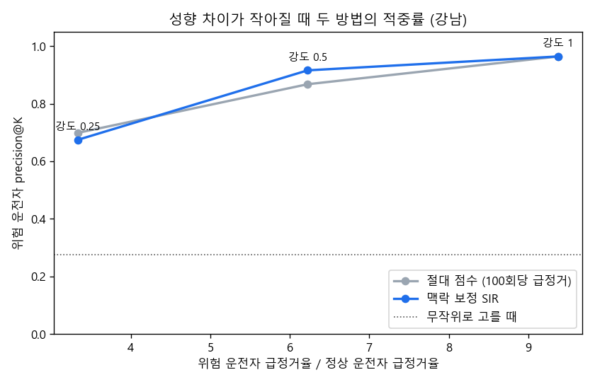

# 1단계 반복·민감도 실험 결과

모든 실험: SUMO, 실제 한국 지도(OpenStreetMap), 28일, 운전자 300명 + 배경 교통, 돌발 약 20건.

## 반복 실험 (지역 × 시드)

| 실험 | 정상 운전자 급정거/100회 | 위험/정상 배율 | 위험 운전자: 절대 → 맥락 | 절대 점수 오탐 중 혼잡경로 | 효과 있던 돌발: 절대 → 맥락 → 스캔 |
|---|---|---|---|---|---|
| 강남 시드 3 | 3.5 | 9.38배 | 0.96 → **0.96** | 67% | 0.00 → **0.94** → 0.94 (17/20건) |
| 강남 시드 4 | 3.6 | 8.58배 | 0.94 → **0.99** | 100% | 0.00 → **0.86** → 0.86 (14/14건) |
| 강남 시드 5 | 3.5 | 9.19배 | 0.97 → **0.98** | 100% | 0.00 → **0.93** → 0.93 (15/16건) |
| 판교 시드 3 | 2.6 | 8.42배 | 0.96 → **0.99** | 100% | 0.00 → **1.00** → 1.00 (17/18건) |
| 판교 시드 4 | 2.7 | 7.95배 | 0.97 → **0.99** | 67% | 0.00 → **0.85** → 0.77 (13/14건) |

- 평균 (± 표준편차, 5회): 위험 운전자 적중률 절대 0.96 ± 0.01, 맥락 **0.98 ± 0.01**; 효과 있던 돌발 적중률 맥락 **0.92 ± 0.06**, 스캔 0.90 ± 0.09

## 민감도: 위험 운전자가 정상과 얼마나 다를 때 찾을 수 있나 (강남 시드 3)

| 성향 강도 | 위험/정상 급정거 배율 | 절대 점수 | 맥락 보정 |
|---|---|---|---|
| 0.25 | 3.34배 | 0.70 | **0.67** |
| 0.50 | 6.23배 | 0.87 | **0.92** |
| 1.00 | 9.38배 | 0.96 | **0.96** |

